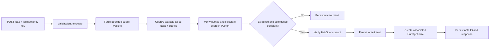

# Lead Qualification Agent

A small, auditable Agent service that accepts a sales lead, reads its public
company website, extracts evidence-backed facts, applies deterministic ICP rules,
and adds a note to the matching HubSpot contact. Low-confidence or unsupported
results are returned for human review and are never written to the CRM.

This is a production-minded POC, not a claim that customer-specific qualification
criteria are known. The checked-in policy is a **demo assumption** and must be
replaced with approved ICP rules before a customer relies on its scores.

## End-to-end flow



LangGraph coordinates the explicit fetch → extract → score/gate → CRM workflow.
The model does not choose its own tools or calculate the final score. Website
content is untrusted input. Quotes are checked against the fetched page before
they can support a CRM write. The deterministic scorer and JSON policy make
results reproducible and reviewable.

## API

`POST /leads/qualify` requires `Authorization: Bearer ...` and an
`Idempotency-Key` header (8–200 characters).

```json
{
  "contact_id": "123456",
  "company_name": "Example Robotics",
  "website": "https://example.com",
  "email": "buyer@example.com"
}
```

Success returns a `completed` or `review_required` status, a validated report,
and (only for a completed HubSpot write) the note ID. Reusing the same key and
same body replays the saved result. Reusing it with a different body returns
`409`. An active duplicate returns `409` with `Retry-After`. A HubSpot write with
an unknown network outcome is not blindly retried: the record is flagged for
manual reconciliation to avoid creating duplicate notes.

Useful endpoints:

- `GET /healthz`: process liveness.
- `GET /readyz`: app and database readiness.
- `GET /docs`: interactive OpenAPI docs (protect this behind your network policy
  in a shared deployment).

## Demo scoring policy

See [`config/qualification_policy.json`](config/qualification_policy.json).
The sample ICP uses logistics, warehouse, manufacturing, and robotics; a
50-employee size threshold; and sample weights for industry, size, product fit,
growth, evidence, and risk. These are **not customer requirements**. Before
production use, confirm the target industries, firmographic source, score
weights, thresholds, risk treatment, acceptable evidence, and human-review
policy with the customer. Scoring is deterministic, but extracted facts and the
model confidence are not ground truth.

## Local setup

Requires Python 3.11+ and `uv` (or use pip editable install).

```powershell
uv sync --extra dev
Copy-Item .env.example .env
```

For local-only API development, edit `.env` with an API bearer token and an
OpenAI key. Do not configure HubSpot until you are ready for a real CRM write.
Start the API:

```powershell
uv run uvicorn rss_surveillance_agent.api:app --reload --port 8000
```

SQLite is used when `DATABASE_URL` and `DB_HOST` are unset. A live request can
fetch an external website and incur model charges; tests use fakes and do not
call websites, OpenAI, or HubSpot.

```powershell
$headers = @{
  Authorization = "Bearer $env:API_BEARER_TOKEN"
  "Idempotency-Key" = "lead-demo-0001"
}
$body = @{
  contact_id = "123456"
  company_name = "Example Robotics"
  website = "https://example.com"
} | ConvertTo-Json
Invoke-RestMethod http://localhost:8000/leads/qualify -Method Post -Headers $headers -ContentType "application/json" -Body $body
```

## Tests and checks

```powershell
uv run pytest -q
uv run ruff check src tests migrations
```

Tests cover policy scoring, quote grounding, website security and limits, API
authentication/validation, idempotency and replay, HubSpot payloads, and model
budget enforcement. External services are mocked. PostgreSQL migration and
integration checks run in CI; set `TEST_DATABASE_URL` to run that integration
test locally.
SQLite creates its local development schema automatically. Run Alembic only
against a configured PostgreSQL database, for example with the migration URL
environment variables from Compose.

## Compose deployment

The Compose setup runs PostgreSQL, applies Alembic migrations, and runs one API
instance as a non-root user with dropped capabilities and a read-only root
filesystem. The published port binds to loopback only. Place a TLS reverse proxy
or private gateway in front of it when remote clients need access; do not expose
the container port directly to the public internet.

1. On a Linux host with Docker Compose, copy `.env.example` to `.env`.
2. Replace every placeholder with unique generated secrets. Use a secret manager
   for a shared deployment; `.env` is for a small single-host POC only.
3. Configure an OpenAI key/model and a HubSpot private-app token with only the
   required contact-read and note-write access. Use a test HubSpot account first.
4. Run `docker compose config --quiet` and inspect the resolved configuration
   without printing secrets; then `docker compose up --build -d`.
5. Check `docker compose ps`, `docker compose logs --tail=100 migrate agent`, and
   `curl http://127.0.0.1:8000/readyz`.

Use a managed PostgreSQL instance, centralized secret storage, TLS termination,
egress filtering, log/metric collection, spend limits, encrypted backups, and a
tested restore process before production traffic. This repository does not
include autoscaling, a queue, tenant isolation, a browser-rendering crawler, or
an operator dashboard. The single API process is appropriate for a bounded POC;
long-running crawls or higher request volume should move to a durable job queue.

## Security and operational limits

- The fetcher permits only HTTP(S) on ports 80/443, rejects non-public DNS
  answers, caps redirects to the same host, response bytes, and execution time,
  and accepts HTML only. DNS rebinding protection also requires network-level
  egress controls; the application check alone is not a complete network
  sandbox. JavaScript-rendered pages are not supported.
- OpenAI SDK retries are disabled. A durable UTC daily call counter bounds model
  attempts. Configure provider-side monetary limits too; request counts are not
  dollar limits.
- CRM write intent is persisted before POST. A timeout after the remote side
  accepts a note is inherently ambiguous without an idempotency facility from
  HubSpot; the service sends that case to manual reconciliation rather than
  automatically repeating the write.
- The app stores request hashes, reports, evidence quotes, state, and CRM note
  IDs in the database. Define retention and deletion rules before real customer
  data is processed. Avoid putting secrets or personal contact data into logs.
- `API_BEARER_TOKEN` is a simple service credential, not per-user authentication.
  For production, put this behind an identity-aware gateway and rate limiter.

## HubSpot setup

The adapter verifies the contact by ID and creates a CRM note associated with
that contact. API date version defaults to `2026-09` (current GA release as of October 2026) and can be changed with
`HUBSPOT_API_VERSION`. Check the current HubSpot API version and private-app
scopes before deployment because vendor APIs evolve. The note association uses
the documented HubSpot-defined contact association type. See the [HubSpot CRM
objects API guide](https://developers.hubspot.com/docs/api-reference/latest/crm/objects/notes)
and [Fall 2026 API release notes](https://developers.hubspot.com/changelog/fall-2026-spotlight).

## Existing RSS learning module

The earlier RSS surveillance implementation remains in the package and its
existing tests, but it is no longer the default Compose service. It can still be
run with `rss-surveillance` while studying the original polling/outbox lessons.
